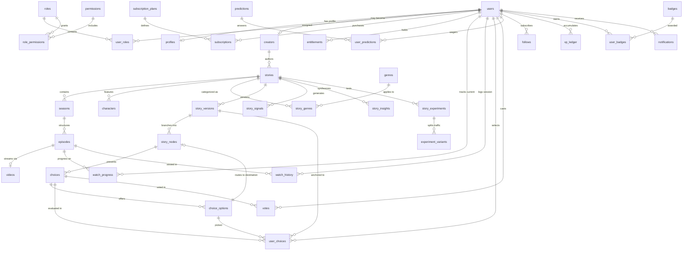
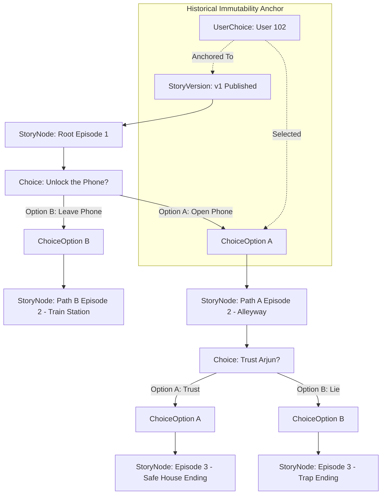

# 05. SHORTREEL — ENTITY RELATIONSHIP (ER) MODEL

> **Document ID:** SR-ARCH-05  
> **Phase:** Phase 4 — Backend Architecture & Technical Design Freeze  
> **Status:** RATIFIED & FROZEN  

---

## 1. Complete Core Entity Relationship Diagram

---

## 2. Interactive Narrative Graph Sub-Model

The interactive story engine represents a deterministic directed graph embedded directly within MySQL tables:

---

## 3. Many-to-Many Relationships & Junction Entities

| Entity A | Entity B | Conceptual Relation | Junction Table in MySQL | Foreign Key Constraints |
| :--- | :--- | :--- | :--- | :--- |
| `users` | `roles` | Users have multiple roles | `user_roles` | `user_id` FK -> `users(id)` `role_id` FK -> `roles(id)` |
| `roles` | `permissions` | Roles grant multiple permissions | `role_permissions` | `role_id` FK -> `roles(id)` `permission_id` FK -> `permissions(id)` |
| `stories` | `genres` | Stories belong to multiple genres | `story_genres` | `story_id` FK -> `stories(id)` `genre_id` FK -> `genres(id)` |
| `stories` | `tags` | Stories have multiple search tags | `story_tags` | `story_id` FK -> `stories(id)` `tag_id` FK -> `tags(id)` |
| `users` | `badges` | Users unlock multiple achievements | `user_badges` | `user_id` FK -> `users(id)` `badge_id` FK -> `badges(id)` |
| `users` | `targets` (Creator, Story, Character)| Users follow entities polymorphically | `follows` | `user_id` FK -> `users(id)` `target_type` + `target_id` index |

---

## 4. Referential Integrity Rules

1. **Delete Cascades:**
   - Deleting a `StoryVersion` (in draft only) cascades to its `StoryNodes`, `Choices`, and `ChoiceOptions`.
   - Deleting a `User` cascades to `Profiles`, `UserRoles`, and `Follows`.
2. **Delete Restrictions:**
   - A `Story` cannot be deleted if active `Subscriptions`, `WatchProgress`, or `PublishedStoryVersions` reference it (`ON DELETE RESTRICT`). Soft deletion (`deleted_at`) is mandatory.
   - An `Episode` cannot be deleted if referenced by a `Video` or active `StoryNode`.
3. **Immutability Enforcement:**
   - A `StoryVersion` in status `PUBLISHED` disallows updates to `story_nodes` or `choices` via database triggers or application service guards.
